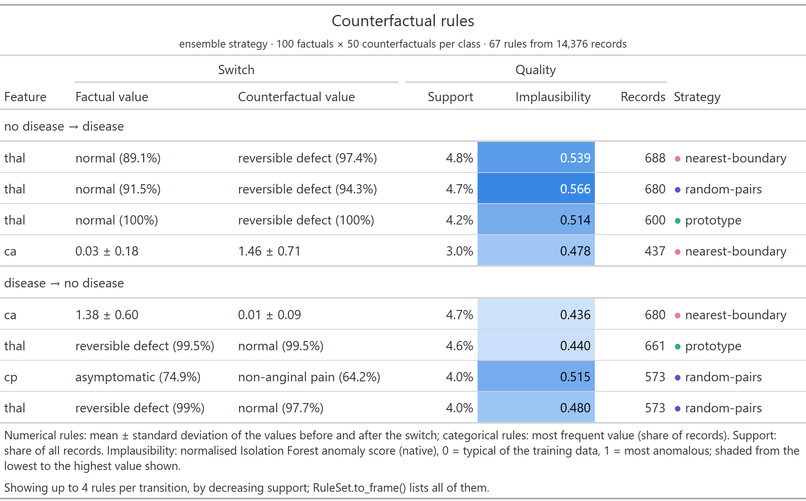
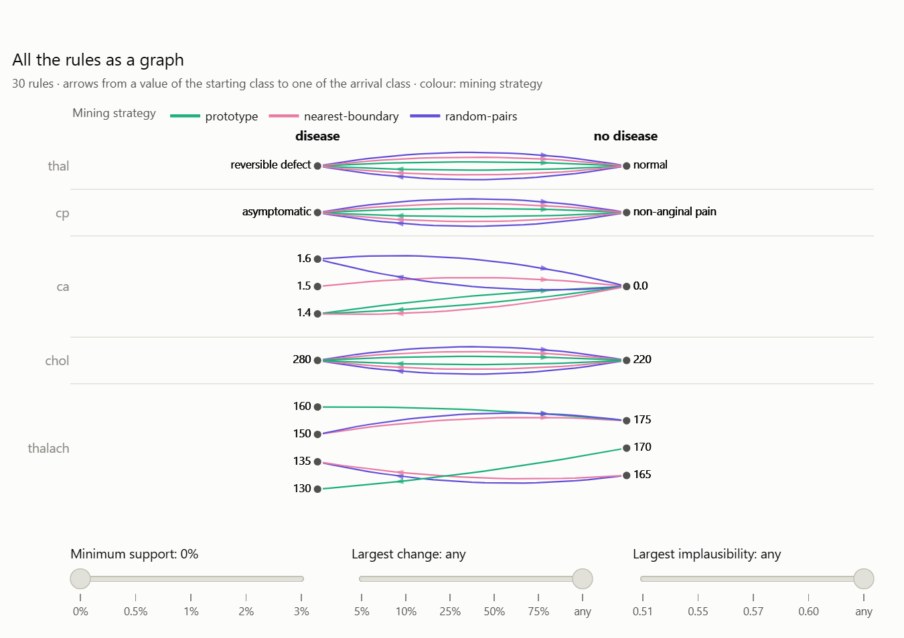
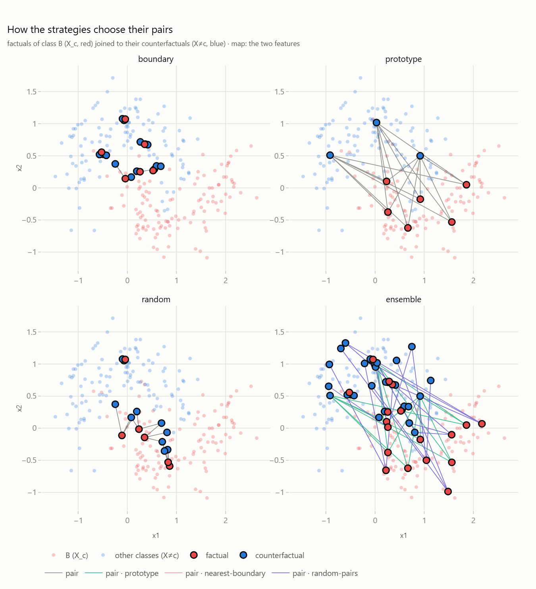

# RaMiCo

[](https://pypi.org/project/ramico/)
[](https://pypi.org/project/ramico/)
[](https://github.com/ClaudioDaka99/RaMiCo/actions/workflows/ci.yml)
[](LICENSE)

**Region-Aware Minimal Counterfactual Rules**: model-agnostic extraction of global counterfactual rules from
black-box classifiers.

Which change to a sample would change the model's decision, and how consistently across the data? RaMiCo pairs
samples of each class with samples of the other classes, switches one feature at a time and keeps the switches that
flip the model. Aggregated, they become rules such as *thal: reversible defect → normal moves the model from
"disease" to "no disease"*, each with its support and a measure of how realistic its switches are.

- **Model-agnostic**: anything with `predict(X)`, from scikit-learn pipelines to XGBoost or a plain function.
- **Region-aware mining**: boundary, prototype, random and ensemble strategies, or your own.
- **Measured**: fidelity, incomprehensibility and implausibility, as in the paper, with a benchmark and statistical
  tests to compare strategies.
- **Readable**: rules display as rich tables in notebooks, with publication tables, interactive charts and a graph
  of all the rules that sliders thin out.
- **Reusable**: rules, their switches and their metrics go to one JSON file and come back without fitting again.

## Installation

```bash
pip install ramico
```

The core needs only numpy, pandas and gower. Optional extras add the rest:

| Extra | Adds | For |
|---|---|---|
| `ramico[viz]` | plotly, matplotlib, great_tables, kaleido | tables and charts |
| `ramico[benchmark]` | scipy, tqdm | `ramico.benchmark` and its statistical tests |
| `ramico[plausibility]` | YDF | the Isolation Forest of the paper; RaMiCo has its own otherwise (YDF has Windows wheels only up to Python 3.12) |
| `ramico[tutorials]` | all of the above, scikit-learn, XGBoost, imbalanced-learn, ipykernel, Jinja2 | the notebooks in `examples/` |

Extras combine: `pip install "ramico[viz,benchmark]"`. RaMiCo supports Python 3.11 to 3.13.

## Quickstart

```python
from sklearn.compose import make_column_transformer
from sklearn.ensemble import RandomForestClassifier
from sklearn.pipeline import make_pipeline
from sklearn.preprocessing import OneHotEncoder
from ramico import RaMiCo, datasets

data = datasets.load_heart_disease()
encode = make_column_transformer((OneHotEncoder(), data.categorical_features), remainder="passthrough")
model = make_pipeline(encode, RandomForestClassifier(random_state=0)).fit(data.X, data.y)
rules = RaMiCo(model, random_state=0).fit(data.X, data.y, class_names=data.target_names)
rules.to_table(max_rules=4)  # needs ramico[viz]; in a notebook, `rules` alone displays them too
```



Numerical features give intervals (mean ± standard deviation before and after the switch), categorical ones their
most frequent values. The default strategy, the ensemble of the paper, runs three mining strategies and keeps the
rules of each: a switch they all find, such as *thal: normal → reversible defect*, appears once per strategy.
The implausibility above comes from RaMiCo's own Isolation Forest, the one used without the `plausibility` extra.
[How to](#how-to) shows what to do next: read the rules, score them, save them, compare strategies.

## All the rules at a glance



`rules.plot()` draws every rule as an arrow from the value its samples start from to the value
they are switched to: one band per feature, one column per class, the colour of an arrow the mining strategy
that found the rule. Three sliders keep the rules above a minimum support, below a largest change of the feature
and below a largest implausibility. Above, the rules of tutorial 01 on five of its features.

## How the strategies choose their pairs



On a toy dataset with two features, factuals of class B (red) joined to the counterfactuals of class A (blue) they
are switched towards. Boundary mining works where the classes meet, prototype mining pairs typical samples of each
class, random mining samples the whole class, and the ensemble runs three components, each with its own pairs.

## How to

The snippets continue the quickstart: `model`, `rules` and `data` come from there.

### Explain your own model and data

`X` is a DataFrame, or an array with `feature_names`, without missing values. `y` holds the true labels: RaMiCo uses
them to find the samples of each class, as in the paper. Columns with a non-numeric dtype are categorical; name the
others that are, such as integer codes. The model is anything with `predict(X)` that accepts DataFrames with the
columns of `X`, or a plain function.

```python
rules = RaMiCo(model).fit(X, y, categorical_features=["sex", "cp"], class_names=["healthy", "ill"])
rules = RaMiCo(lambda X: (X["chol"] > 240).astype(int)).fit(X, y)
```

### Choose a mining strategy

```python
RaMiCo(model, strategy="prototype", n_factuals=100, n_counterfactuals=50, random_state=0)
```

`strategy` is `"boundary"`, `"prototype"`, `"random"` or `"ensemble"` (the default), or a strategy of your own (see
below). `n_factuals` and `n_counterfactuals` are *s* and *k* of the paper: the factuals mined per class and the
counterfactuals each factual is compared with. Larger values find more switches and take longer. Tutorial 02 compares
the four strategies on Adult.

### Read the rules

```python
rules.to_frame()  # one row per rule
rules.records  # one row per switch
rule = rules[0]  # a Rule: rule.feature, rule.change, rule.support...
rules.records_of(rule)  # the switches behind that rule
rules.filter(from_class=1, to_class=0, feature=["chol", "thalach"])
```

`filter` takes class labels, not display names, and keeps the supports computed on all the rules.

### Score the rules

```python
from ramico import metrics

scores = metrics.evaluate(model, rules, data.X)
scores.fidelity, scores.incomprehensibility, scores.implausibility
```

Fidelity is better high, incomprehensibility and implausibility low. The defaults (`k=7`, `mode="and"`) and the data
(the samples the rules come from) are those of the paper. The metrics also accept the switches of another explainer,
as a DataFrame with the columns of `rules.records`.

### Save the rules and load them back

```python
from ramico import RuleSet

rules.save("rules.json.gz", scores=scores)  # plain JSON, compressed with .gz
rules = RuleSet.load("rules.json.gz")  # no fitting or scoring again
rules.scores.fidelity
```

### Get the same results every time

`random_state=0` fixes the mining and RaMiCo's own Isolation Forest. With YDF installed, RaMiCo uses YDF's forest, as
the paper did, and its scores vary slightly from run to run; `isolation_forest="native"` keeps RaMiCo's forest, which
follows the same algorithm.

### Draw tables and charts

With `ramico[viz]`:

```python
from ramico import viz

rules.to_table(max_rules=8)  # publication table
figure = rules.plot(min_support=2)  # all the rules, rules under 2% support hidden at first
viz.plot_rule(rules, rules[0])  # the switches behind one rule
viz.show(figure, static=True)  # adds a PNG copy for viewers without JavaScript, such as GitHub
```

### Compare strategies on your data

With `ramico[benchmark]`, `run_benchmark` repeats the paper's protocol: for every seed it splits the data, fits a new
model on the training part, then extracts and scores the rules of each strategy there.

```python
from ramico import benchmark

results = benchmark.run_benchmark(
    lambda seed: make_pipeline(encode, RandomForestClassifier(random_state=seed)),
    data.X,
    data.y,
    seeds=benchmark.paper_seeds(5),  # the first 5 of the paper's 30 seeds
    cache_dir="runs",  # finished runs are kept and reused
)
comparison = benchmark.compare_strategies(results)  # Mann-Whitney U against the ensemble, Benjamini-Hochberg
viz.comparison_table(results, comparison=comparison)
viz.plot_pareto(results)
```

### Write your own strategy

A strategy receives the samples of one class (`X_c`) and of the others (`X_not_c`) and returns `s` pairs: the position
of a factual in `X_c` and the positions of its `k` counterfactuals in `X_not_c`.

```python
import numpy as np
from ramico.strategies import MiningStrategy, Pair, register_strategy


class Nearest(MiningStrategy):
    """Random factuals, each paired with its k nearest samples of the other classes."""

    name = "nearest"

    def select(self, X_c, X_not_c, s, k, distance, rng):
        factuals = rng.choice(len(X_c), size=min(s, len(X_c)), replace=False)
        d = distance(X_c.iloc[factuals], X_not_c)
        return [Pair(int(f), np.argsort(row, kind="stable")[:k]) for f, row in zip(factuals, d)]


register_strategy("nearest", Nearest)
rules = RaMiCo(model, strategy="nearest", random_state=0).fit(data.X, data.y)
```

`distance` defaults to Gower, which handles mixed data. `RaMiCo(..., distance=f)` replaces it with any function
`f(x, y=None)` that returns the matrix of distances between the rows of two DataFrames.

## Tutorials

| Notebook | What it shows | |
|---|---|---|
| [01 · Quickstart](examples/01_quickstart.ipynb) | rules of a heart-disease classifier, the anatomy of a rule, all the rules as a graph, the three metrics, saving and reloading the results | [](https://colab.research.google.com/github/ClaudioDaka99/RaMiCo/blob/main/examples/01_quickstart.ipynb) |
| [02 · Mining strategies](examples/02_mining_strategies.ipynb) | the pairs of each strategy, their comparison on Adult over 30 seeds, the Pareto trade-off | [](https://colab.research.google.com/github/ClaudioDaka99/RaMiCo/blob/main/examples/02_mining_strategies.ipynb) |

Both notebooks have a `QUICK` parameter for a short run with the same tables and figures, and a `MODEL` parameter
that chooses the black box of the paper: `"xgboost"` (the runs shown) or `"mlp"`. Run them with
`pip install "ramico[tutorials]"`.

## Reproducing the paper

RaMiCo summarises numerical features by mean ± standard deviation, as the paper describes. The original
implementation, which produced the published numbers, summarised them by their most frequent value whenever the data
also had categorical features, so on those data the package gives slightly different numbers. The code and the
results of the paper's experiments are on the `main` branch at commit `e31a030`.

## Citation

If you use RaMiCo, please cite:

```bibtex
@inproceedings{daka2026sampling,
  title     = {Evaluation of Different Region-Aware Sampling Strategies on Counterfactual Rule Extraction},
  author    = {Daka, Claudio and Gagliardi, Guido and Alfeo, Antonio Luca and Cimino, Mario G. C. A.},
  booktitle = {2026 IEEE International Conference on Evolving and Adaptive Intelligent Systems (EAIS)},
  address   = {Pisa, Italy},
  publisher = {IEEE},
  pages     = {1--8},
  year      = {2026},
  doi       = {10.1109/EAIS69050.2026.11759992}
}

@article{gagliardi2025ramico,
  title   = {Region-aware Minimal Counterfactual Rules for Model-agnostic Explainable Classification},
  author  = {Gagliardi, Guido and Alfeo, Antonio Luca and Guidotti, Riccardo and Cimino, Mario G. C. A.},
  journal = {Machine Learning},
  volume  = {114},
  number  = {10},
  pages   = {225},
  year    = {2025},
  doi     = {10.1007/s10994-025-06847-5}
}
```

## License

MIT, see [LICENSE](LICENSE).
