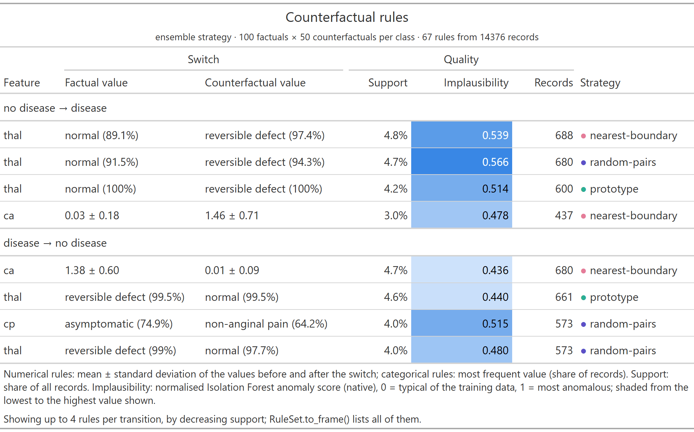
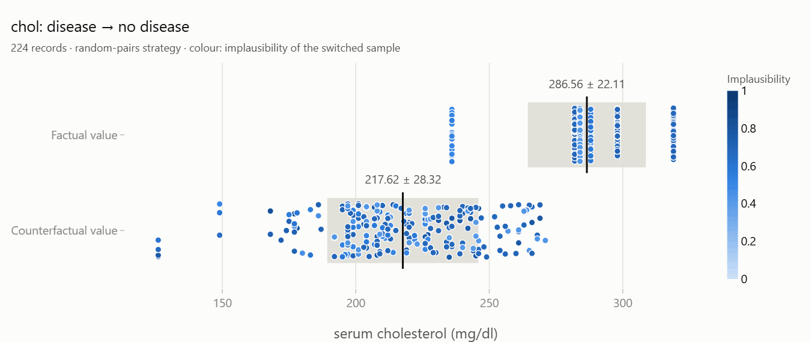
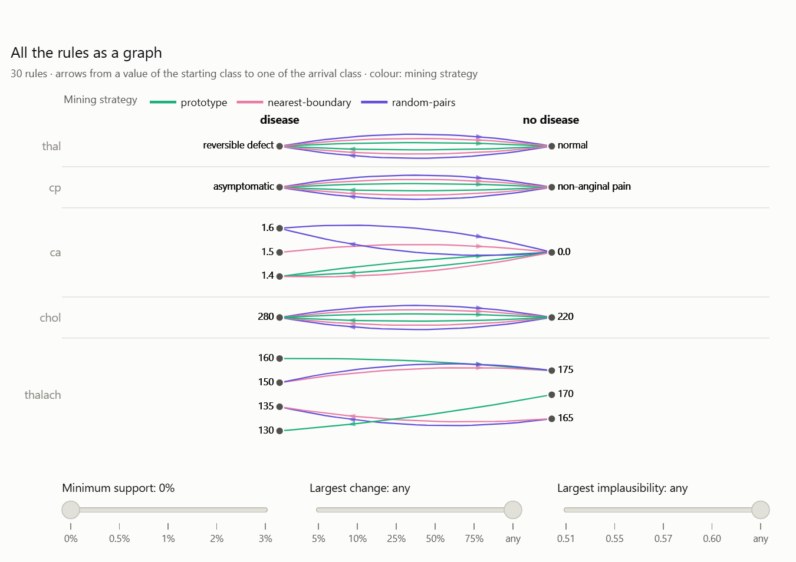
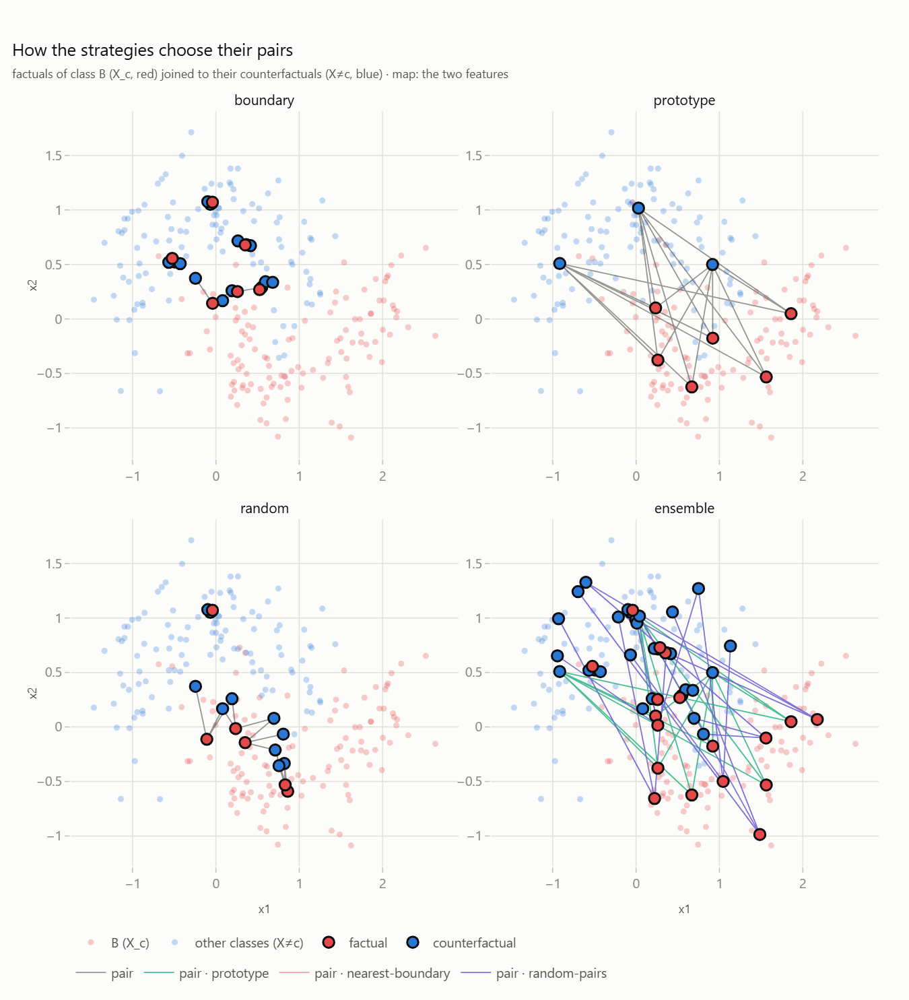
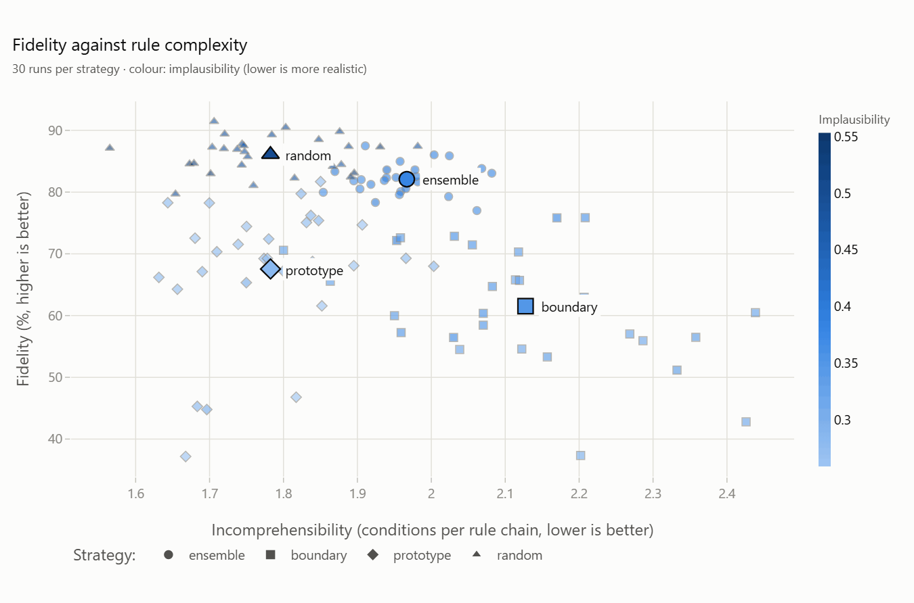

# RaMiCo

**Region-Aware Minimal Counterfactual Rules**: model-agnostic extraction of global counterfactual rules from
black-box classifiers.

Which change to a sample would change the model's decision, and how consistently across the data? RaMiCo pairs
samples of each class with samples of the other classes, switches one feature at a time and keeps the switches that
flip the model. Aggregated, they become rules with an interval or a value before and after the switch, a support and
a measure of how realistic the switched samples are.

```python
from ramico import RaMiCo

rules = RaMiCo(model, random_state=0).fit(X_train, y_train)
rules  # in a notebook: a table per class transition
```

- [Install RaMiCo](installation.md) with the extras you need.
- Read how [the algorithm](concepts/algorithm.md), [the mining strategies](concepts/strategies.md) and
  [the metrics](concepts/metrics.md) work.
- Follow the [tutorials](tutorials/01_quickstart.ipynb), from a first rule set to a benchmark with statistical tests.

## Gallery

<div class="grid" markdown>

[](tutorials/01_quickstart.ipynb)
**[01 · Quickstart](tutorials/01_quickstart.ipynb)**: the rules of a heart-disease classifier, as a publication
table.

[](tutorials/01_quickstart.ipynb)
**[01 · Quickstart](tutorials/01_quickstart.ipynb)**: one rule opened up, every record that supports it coloured by
how realistic its switch is.

[](tutorials/01_quickstart.ipynb)
**[01 · Quickstart](tutorials/01_quickstart.ipynb)**: all the rules as a graph, thinned out by support, size of the
change and implausibility.

[](tutorials/02_mining_strategies.ipynb)
**[02 · Mining strategies](tutorials/02_mining_strategies.ipynb)**: the pairs each strategy chooses, on a toy dataset
with two features.

[](tutorials/02_mining_strategies.ipynb)
**[02 · Mining strategies](tutorials/02_mining_strategies.ipynb)**: the trade-off between faithful and concise rules
over 30 random splits of Adult, with the Pareto front.

</div>

## Citing RaMiCo

Please cite the paper on the mining strategies and the original RaMiCo paper; the BibTeX entries are in the
[README](https://github.com/ClaudioDaka99/RaMiCo#citation) and in `CITATION.cff`.
